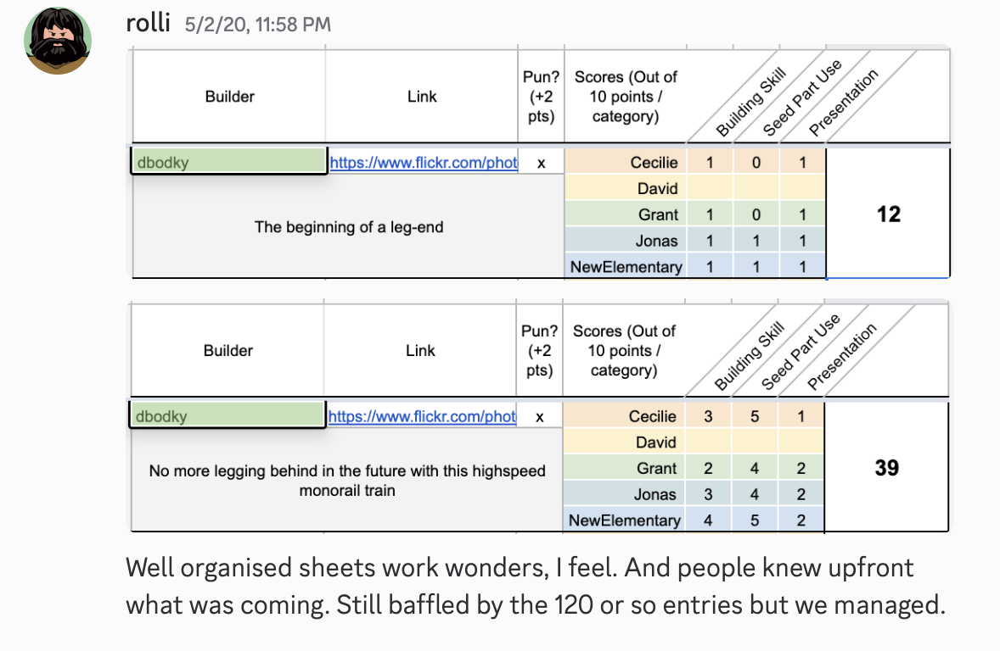
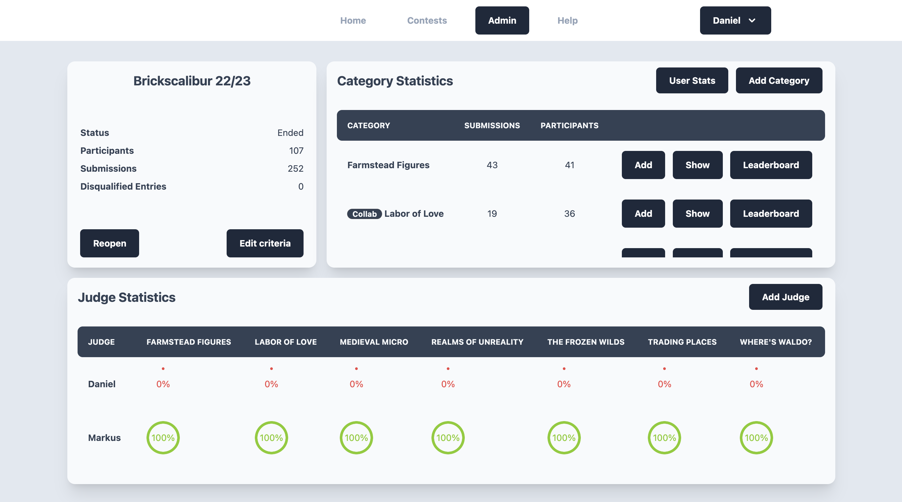
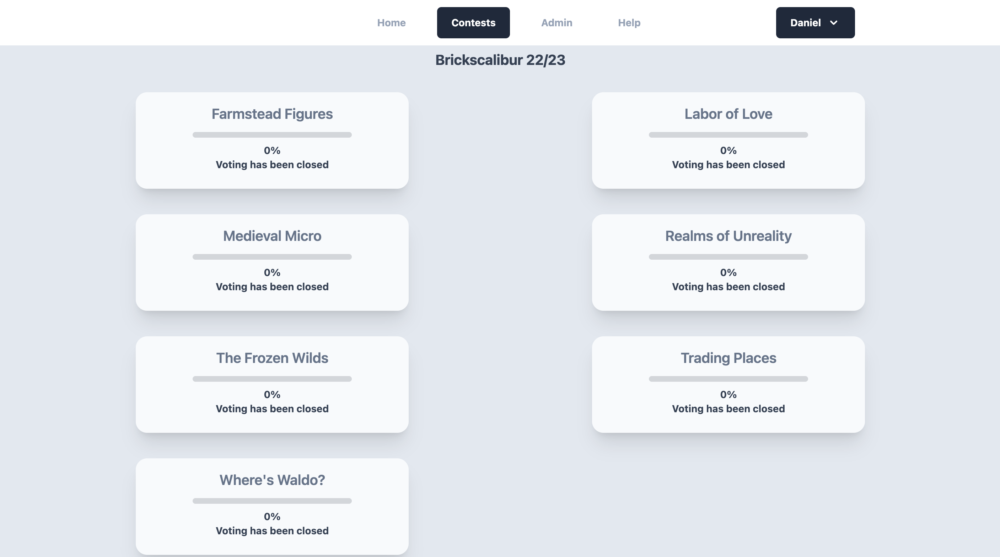

# Organizing LEGO Building Contests for Online Communities

## with BrickContests

---
layout: image-right
image: ./sigfig.png
---

# About me

 

 

- Daniel (dbodkylego)
- Member of RogueBricks LUG
- AFOL since 2020
- I like building contests, just not _participating_ in them

---
layout: section
---

# How it all started

---

# The Timeline

<Timeline
  :visible="1"
  :entries="[
    { date: '2020-05', label: 'Daniel participates in the IronForge' },
    { date: '2021-11', label: 'RogueBricks launch Brickscalibur' },
    { date: '2025-12', label: 'Multiple community-run contests use BrickVote' },
    { date: '2026-06', label: 'BrickContests goes live' },
  ]"
/>

---

---

# IronForge 2020

 

What I saw:

- ~120 entries in the first round
- 5 jury members
- all managed through spread sheets

The implications:

- Each checkmark, username, build info, and link had to be entered manually
- Working with sheets can be brittle (misclicks, duplicated inputs/sheets, etc.)

---

<Timeline
  :visible="2"
  :entries="[
    { date: '2020-05', label: 'Daniel participates in the IronForge' },
    { date: '2021-11', label: 'RogueBricks launch Brickscalibur' },
    { date: '2025-12', label: 'Multiple community-run contests use BrickVote' },
    { date: '2026-06', label: 'BrickContests goes live' },
  ]"
/>

---
layout: two-cols
---

# Brickscalibur and Iron Forge

 

- both contests created by _rolli_ and supported by RogueBricks
- both feature many participants, jury members, and submissions
- both come with complex scoring mechanisms for specific categories

 

  

<v-click>

## "We _have_ to write a tool for that!"

</v-click>

::right::

---

# Brickscalibur and Iron Forge

 

The first Brickscalibur had ...

- ... _181_ submissions by _~100_ participants
- ... _6_ jury members
- ... _3258_ submission scores
- ... a broad idea of what a contest organizing tool could look like

 

## ... and _BrickVote_ was born

---
layout: section
---

# How it continued

---

---

---

<Timeline
  :visible="3"
  :entries="[
    { date: '2020-05', label: 'Daniel participates in the IronForge' },
    { date: '2021-11', label: 'RogueBricks launch Brickscalibur' },
    { date: '2025-12', label: 'Multiple community-run contests use BrickVote' },
    { date: '2026-06', label: 'BrickContests goes live' },
  ]"
/>

---

# Fast-Forward to 2025

Other community contests came to _BrickVote_ by word-of-mouth:

  Summer Joust <small>InnovaLUG</small>
  Vignweek <small>RebelLUG</small>
  MELO <small>LOTRLUG</small>
  Marchitecture <small>by Rauy</small>

<v-click>

  

54

contest rounds

  

154

categories

  

1,563

participants

  

3,909

submissions

  

75

jury &amp; admin users

  

61,012

jury votes

on <em>BrickVote</em> over four years

</v-click>

---

# Problems with BrickVote

 

It wasn't all smooth sailing:

- the admin dashboard took minutes **!** to load once enough votes were cast
- admins needed to enter _every. single. submission._ themselves Editing those submissions was a pain, too
- jury workflows were lacking usability and speed
- you needed to know me (or rolli) to be able to use BrickVote

 

 

<v-click>

## It was time for a successor!

</v-click>

---
layout: section
---

# Where we are now

---

<Timeline
  :visible="4"
  :entries="[
    { date: '2020-05', label: 'Daniel participates in the IronForge' },
    { date: '2021-11', label: 'RogueBricks launch Brickscalibur' },
    { date: '2025-12', label: 'Multiple community-run contests use BrickVote' },
    { date: '2026-06', label: 'BrickContests goes live' },
  ]"
/>

---

# Tenets of BrickContests

 

A few things I had in mind when working on BrickVote's successor:

- **_Anyone should be able to organize contests_** - The website is public, and anyone can sign up.
- **_Contests should be discoverable_** - Organizers can post contests well in advance, so FOLs have a chance of discovering them in time.
- **_Contests deserve archives_** - Each contest keeps its contents indefinitely after it ends, for FOLs to browse through.
- **_Admins deserve some sleep_** - Participants now submit their MOCs themselves. Admins can still moderate their contests.

---

# What BrickContests can do today

 

Features currently available in BrickContests:

- Public and private contests
- Managing jury and co-admins
- Moderating contests, categories, and submissions
- Collab-feature for MOCs by groups of creators
- Social links (Discord, Instagram, Flickr, Youtube), comments, and reactions for MOCs
- Leaderboards for contests, categories, and custom criteria
- Mobile-friendly for admins, juries, and participants

 

<v-click>

## But did the FOL community want something like this?

</v-click>

---
layout: section
---

# The legal stuff

---

# I don't want your data (and others won't get it)

 

What you can count on if you use BrickContests:

- The service is hosted entirely in the EU (Germany) and complies with GDPR (DSGVO)
- You keep all rights to uploaded media; I don't reuse, share or publish them anywhere else
- I don't make any money with this, and don't intend to. The cost of maintenance is transparently broken down on the website, as are donations.

 

 

## Privacy Policy and Terms of Service are available on the website

---
layout: section
---

# What's in the future

---

# Plans for BrickContests

 

As more contests will run on the website, I am planning to add more features:

- Better and faster display of media
- Better UX and UI for admins, juries, and participants
- More options to customize leaderboards, categories, prize displays, etc.
- Achievements (general and contest specific)
- Multilingual interface

 

<v-click>

## Got an idea? Let me know 😉

</v-click>

---
layout: section
---

# A big thank you

---

# Without the LEGO community, this wouldn't exist

 

Thanks to all

- Admins who trusted me with their preexisting contests and hosted them on BrickVote and now BrickContests
- Jury members who used (rather **endured**) the platform(s) over the years, and provided feedback
- FOLs who signed up to this new website and submitted beautiful MOCs already

---

# Special thanks

 

These two trusted me with their contests for the past 5 years, provided tons of feedback, and kept their calm when things went wrong.

  

    
    rolli
  

  

    
    soccerkid6
  

---

# Thanks to you - for listening!

 

Here's a few helpful links:

- [brickcontests.com](https://brickcontests.com) if you want to host your own contest or participate in one
- [brickcontests.com/faq](https://brickcontests.com/faq) if you've got questions
- [brickcontests.com/how-to](https://brickcontests.com/how-to) for ways to get started
- [slides.dbodky.me/brickcontests](https://slides.dbodky.me/brickcontests) if you want to share these slides with other FOLs
