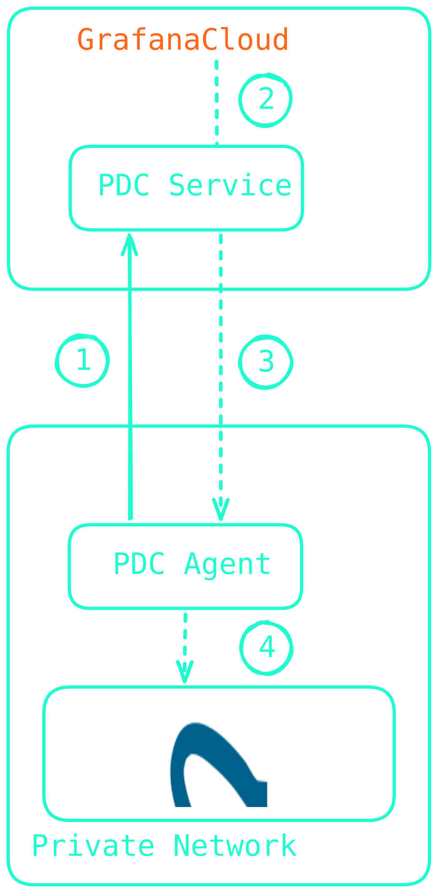
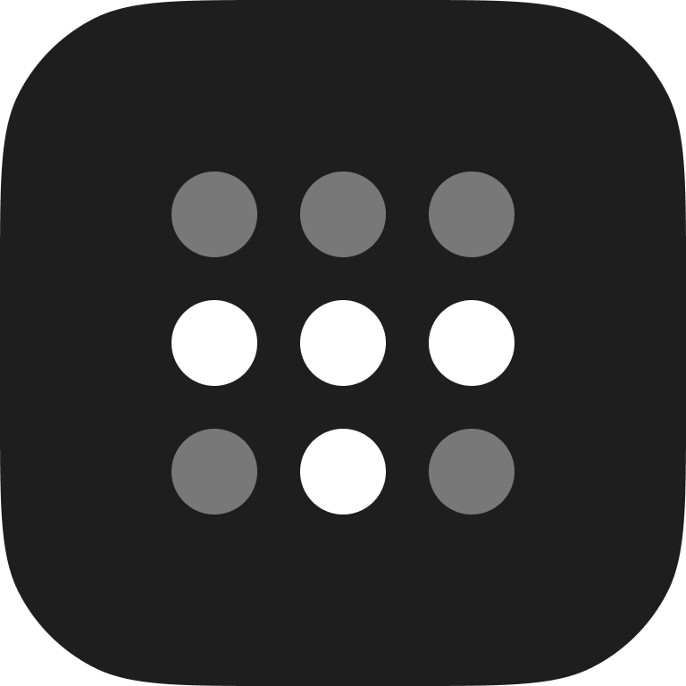

# Keep your data and query it, too, with Grafana PDC

## Connecting private data sources to Grafana Cloud

September 29, 2026 Grafana Meetup Nürnberg

---
layout: two-cols
---

# About Me

::left::

- Senior Developer Advocate at **NETWAYS Web Services**, a sovereign German cloud provider
- Main interests
  - Kubernetes
  - Observability
  - GitOps
- Grafana Champion

::right::

  

---
layout: section
---

# What is Grafana PDC?

---

# <u>P</u>rivate <u>D</u>atasource <u>C</u>onnect

## An agent you control

- Install the PDC agent in your infrastructure:
  - as Binary
  - on Docker
  - on Kubernetes
- Provide it with a Grafana Cloud token
- Query your private data sources through the PDC agent

---
layout: two-cols
---

# How it works

::left::

1. The PDC agent creates a secret tunnel with the PDC service via SSH.
2. Grafana Cloud starts a query against the data source through the PDC service.
3. The query gets forwarded through the established SSH tunnel via SOCKS as-is.
4. The PDC agent resolves the target data source and forwards the query.

Figure adapted from the <a href="https://grafana.com/docs/grafana-cloud/observe-and-act/connect-externally-hosted/private-data-source-connect/#private-data-source-connect-pdc-concepts" target="_blank">Grafana PDC documentation</a>

::right::

---

# What I Like About the PDC Agent

## A no-nonsense infrastructure component

 

 

- It's <a href="https://github.com/grafana/pdc-agent" target="_blank">Open Source </a>
- It doesn't reinvent the wheel, but builds on top of OpenSSH and the SOCKs protocol
- Configuration and scaling is very easy
- It's available for various deployment modes (Binary, Docker, Kubernetes)

---

# Limitations of the PDC Agent

## Things to keep in mind

- PDC only supports **backend** data source plugins. If Grafana wants to query something from the frontend, it **won't** reach the proxy.
- Each PDC agent uses a **single-threaded** OpenSSH process. Configuring multiple concurrent processes requires configuring the agent, or scaling it horizontally.
- The SOCKS protocol used for forwarding queries **adds latency**. Typically tens of milliseconds, neglibile for most use-cases.
- It's only usable in the context of Grafana Cloud.

---
layout: section
---

# Demo Time

---
layout: two-cols
---

# PDC with Tailscale

## Connect to your data sources without managing agents

::left::

Instead of the PDC agent, you can use <a href="https://tailscale.com" target="_blank">Tailscale</a> to connect Grafana Cloud to your data sources.

Tailscale is a managed connectivity platform that can be used as VPN, SASE, PAM, etc.

It connects your workloads through a dedicated _Tailnet_.

::right::

---

# PDC with Tailscale

## Connect to your data sources without managing agents

1. Add your data source (APIs, databases, etc.) to your _Tailnet_.  E.g. by adding the host it's running on to your Tailnet or provisioning a sidecar container.
2. Generate and pass an _Auth Key_ to the data source configuration in Grafana Cloud.
3. Configure access policies in the Tailscale console.

 

 

 

 

 

_Grafana PDC with Tailscale is currently in private preview. You can sign up for access <a href="https://forms.gle/ZyG714ABiUq4Auiv8" target="_blank">here</a>._

---
layout: section
---

# Demo Time

---

# When PDC Might be Useful for You

## Scenarios to think about

- Internal APIs you want to query that aren't accessible from the outside.
- Stored data that you either...
  - ..._don't want_ to store in Grafana Cloud (e.g. for cost or retention reasons)
  - ..._aren't allowed_ to store in Grafana Cloud (e.g. for legal reasons)
  - ..._can't send_ to Grafana Cloud (e.g. contents of databases, data in legacy formats)

 

 

Grafana PDC currently supports <a href="https://grafana.com/docs/grafana-cloud/observe-and-act/connect-externally-hosted/private-data-source-connect/#supported-data-sources" target="_blank">68 Open Source and Enterprise data sources</a>.

---

# Thank You for Your Attention

## Any Questions?

 

 

- **Slides**: [slides.dbodky.me/grafana-meetup-2026-09](https://slides.dbodky.me/grafana-meetup-2026-09)
- **Docs**: [grafana.com/docs](https://grafana.com/docs/grafana-cloud/observe-and-act/connect-externally-hosted/private-data-source-connect/)
- **GitHub Repository**: [grafana/pdc-agent](https://github.com/grafana/pdc-agent)
